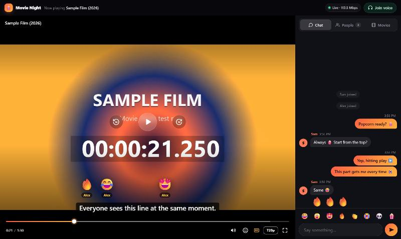
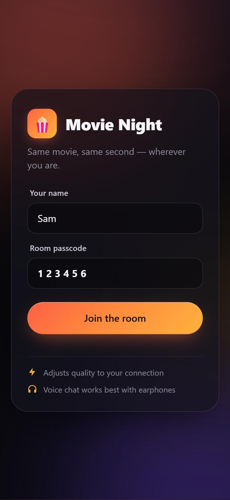
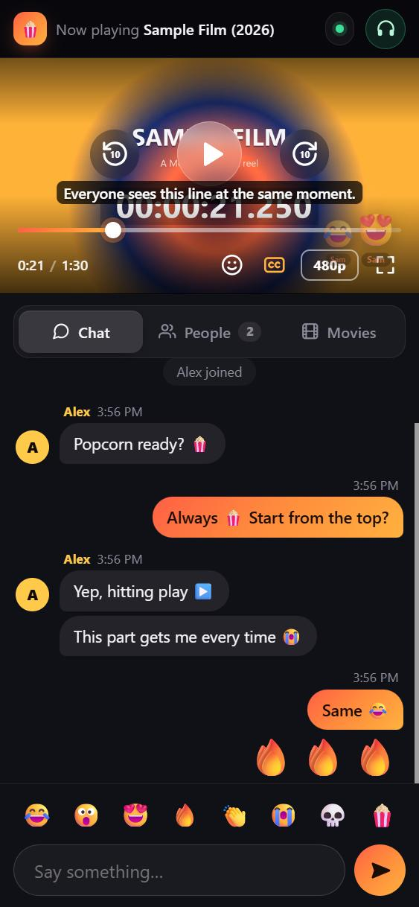
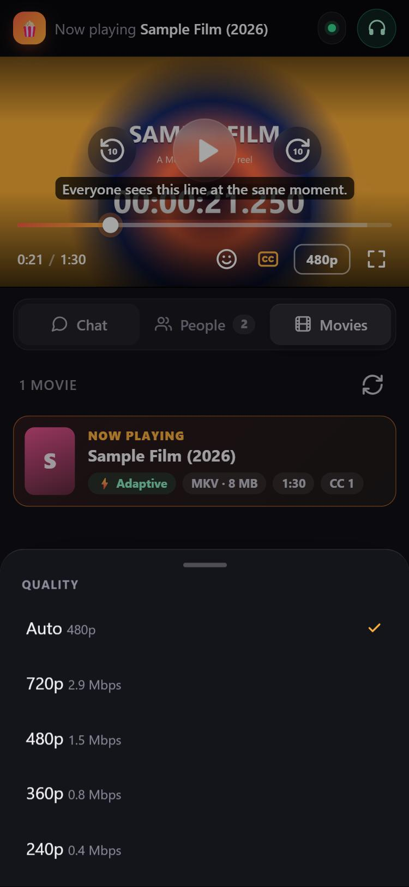
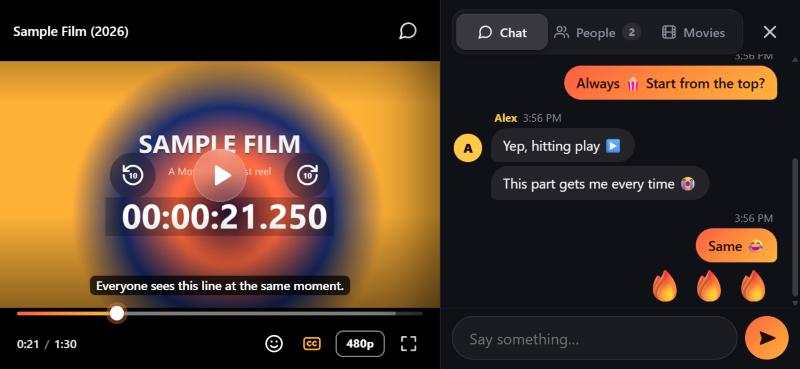
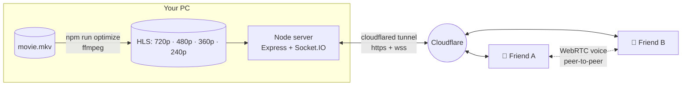

<div align="center">

# 🍿 Movie Night

**Watch a movie from your PC with friends — in perfect sync, with chat, reactions and voice.**
Works on phones and desktops, and keeps playing smoothly on slow connections.




</div>

<table>
  <tr>
    <td align="center"><br><sub><b>Join with a passcode</b></sub></td>
    <td align="center"><br><sub><b>Watch + chat on a phone</b></sub></td>
    <td align="center"><br><sub><b>Adaptive quality</b></sub></td>
  </tr>
</table>

<p align="center">
  <br>
  <sub><b>Turn the phone sideways — full-screen video with chat beside it</b></sub>
</p>

---

## Contents

- [Why](#why)
- [Quick start](#quick-start)
- [Features](#features)
- [How it works](#how-it-works)
- [Slow networks](#slow-networks)
- [Commands & options](#commands--options)
- [Troubleshooting](#troubleshooting)
- [Project structure](#project-structure)

## Why

You have the movie file. Your friends are somewhere else. Movie Night turns your PC into a private
streaming server — no uploading, no accounts, no subscriptions. Everyone opens a link on their phone,
types a passcode, and watches the same frame at the same moment.

## Quick start

### 1. Install the prerequisites (once)

| Tool | Why | Install (PowerShell as **Administrator**) |
|---|---|---|
| [Node.js](https://nodejs.org) 18+ | runs the server | `choco install nodejs-lts -y` |
| [cloudflared](https://developers.cloudflare.com/cloudflare-one/connections/connect-networks/) | free public `https://` link | `choco install cloudflared -y` |
| [FFmpeg](https://ffmpeg.org) | prepares movies for slow networks | `choco install ffmpeg -y` |

> Prefer winget? Run `winget install --id Cloudflare.cloudflared`, `winget install --id Gyan.FFmpeg`
> and `winget install --id OpenJS.NodeJS.LTS`. Open a **new** terminal afterwards so the tools are found.

```powershell
git clone https://github.com/purna135/Movie-Night.git
cd Movie-Night
npm install
```

### 2. Add a movie and optimize it

Drop the file into the `movies` folder, then:

```powershell
npm run optimize
```

This converts it once into 720p / 480p / 360p / 240p streams that every phone can play
(HEVC, 10-bit, MKV, AC3/DTS audio are all handled). Expect roughly **5–10× real time with a GPU**,
e.g. ~25 min for a 2h45m film on an Intel laptop iGPU. Already watching? You can start the room
before it finishes — everyone switches to the optimized version automatically when it's ready.

### 3. Start the room

```powershell
npm start
```

…or double-click **`Start Movie Night.cmd`**. The terminal prints a **link, passcode and QR code**:

```
┌────────────────────────────────────────────────────────────┐
  🎬  Movie Night is live — send this to your friend
  Link:      https://something-random.trycloudflare.com
  Passcode:  482913
  Movies:    1 in D:\Movie-Night\movies
└────────────────────────────────────────────────────────────┘
```

Send both to your friends. Keep the terminal open while you watch; `Ctrl+C` stops everything.

## Features

| | |
|---|---|
| 🎯 **Perfect sync** | Play, pause, seek and ±10 s apply to everyone. Small drift is corrected by gently speeding up/slowing down — no jumps. |
| ⏳ **Wait for everyone** | If someone's connection stalls, the room pauses at *their* position and resumes automatically when they catch up. |
| 📶 **Adaptive quality** | Each viewer gets the best quality their connection can sustain and switches as it changes — or picks one manually. |
| 💬 **Chat & reactions** | Grouped chat bubbles, typing indicator, floating emoji reactions. In full screen, new messages pop up over the video. |
| 🎙️ **Voice chat** | Peer-to-peer, echo-cancelled, ~32 kbps so the movie keeps the bandwidth. The movie volume dips while a friend talks. |
| 💬 **Subtitles** | `Film.srt` next to `Film.mp4` just works; text subtitles inside MKVs are extracted by `optimize`. Rendered big and readable on every device. |
| 📱 **Phone-first UI** | Portrait: video + chat. Landscape: full-screen video with chat beside it. Double-tap sides to skip, screen stays awake, chat box stays above the keyboard. |
| 🖥️ **Desktop too** | Side-by-side layout and shortcuts: `Space` play/pause · `←/→` ±10 s · `F` full screen · `M` mute mic · `C` chat. |
| 🔁 **Auto-reconnect** | Dropped Wi-Fi or switched to mobile data? Viewers reconnect and snap back to the right moment, voice included. |
| 🔒 **Private** | Random tunnel URL + passcode + HTTP-only session cookie. The movie stays on your PC and streams only to people you invite, over an encrypted Cloudflare tunnel. |

## How it works



- **Video** is served as [HLS](https://en.wikipedia.org/wiki/HTTP_Live_Streaming) in 4-second chunks. Browsers use
  [hls.js](https://github.com/video-dev/hls.js) (iPhones use native HLS) to pick a quality per chunk.
- **Sync**: the server is the single source of truth for *movie, playing, position*. Clients estimate the
  server clock offset and continuously compare where they are with where the room is.
- **Voice** goes directly between phones (WebRTC); the server only relays the handshake.

## Slow networks

Measured with a bandwidth-limited connection during testing:

| Connection | What happens |
|---|---|
| 600 kbps (weak 3G/4G) | Joins mid-movie, room waits ~3 s, then plays at **240p with zero stalls** |
| Drop from 6 Mbps → 400 kbps mid-movie | Switches down instantly, **no buffering** |
| Recovers to 6 Mbps | Climbs back to 720p within ~30 s |

Stream ladder produced by `optimize` (video + audio):

| Quality | Bitrate | Good for |
|---|---|---|
| 720p | ~2.5 Mbps | Wi-Fi, good 4G |
| 480p | ~1.3 Mbps | average 4G |
| 360p | ~0.7 Mbps | weak 4G / busy Wi-Fi |
| 240p | ~0.4 Mbps | 3G, very poor signal |

> **Your upload speed is shared by everyone.** Two viewers at 720p need ~6 Mbps upload from your PC;
> on less, viewers automatically settle at 480p/360p. A wired connection on the PC helps a lot.

## Commands & options

| Command | What it does |
|---|---|
| `npm start` | Start the server + public tunnel (serves `./movies`) |
| `npm start -- "D:\Films"` | Serve another folder |
| `npm start -- "D:\Films\Movie.mkv"` | Serve that folder and pre-select the file |
| `npm run local` | No tunnel — same Wi-Fi only (voice needs https, so it's off on phones) |
| `npm run optimize` | Prepare all new movies for adaptive streaming |
| `npm run optimize -- --force` | Re-do movies that were already prepared |
| `npm run optimize -- --cpu` | Skip GPU encoders (use if a GPU encode fails) |

Environment variables (set in PowerShell before `npm start`, e.g. `$env:PASSCODE="246810"`):

| Variable | Default | Purpose |
|---|---|---|
| `PASSCODE` | random 6 digits | Keep the same passcode across restarts |
| `PORT` | `8787` (next free) | Local port |
| `TURN_URL`, `TURN_USER`, `TURN_PASS` | — | TURN relay for voice on strict networks |

## Troubleshooting

<details>
<summary><b>"This browser can't play this file's format" / video plays without sound</b></summary>

The original file uses a codec phones can't play (HEVC, 10-bit, AC3/DTS audio…). Run `npm run optimize`,
then tap ↻ in the **Movies** tab — the app switches to the optimized version automatically.
</details>

<details>
<summary><b>Voice says it can't reach my friend</b></summary>

Some mobile carriers block direct peer-to-peer connections. Add a TURN relay (e.g. the free tier at
metered.ca) via `TURN_URL`, `TURN_USER`, `TURN_PASS` and restart.
</details>

<details>
<summary><b>The mic button does nothing</b></summary>

Browsers only allow the microphone on `https://`. Use the tunnel link, not the `http://192.168…` LAN link.
</details>

<details>
<summary><b>Optimize fails or the GPU encoder errors</b></summary>

Run `npm run optimize -- --cpu`. If an optimize was interrupted, just run it again — it starts that movie over
cleanly and refuses to run twice on the same movie at once.
</details>

<details>
<summary><b>Port already in use</b></summary>

The server automatically moves to the next free port, or set `$env:PORT=9000`.
</details>

## Project structure

```
Movie-Night/
├── server.js              # Express + Socket.IO: auth, streaming, room sync, voice signaling, tunnel
├── optimize.js            # ffmpeg → multi-quality HLS + subtitles (GPU-accelerated when available)
├── lib/library.js         # movie discovery, clean titles, prepared-stream lookup
├── public/
│   ├── index.html         # app shell + icons
│   ├── styles.css         # responsive UI (phone portrait/landscape, tablet, desktop)
│   └── app.js             # player, sync, adaptive streaming, chat, voice, reconnects
├── movies/                # put your movie files here (git-ignored)
├── prepared/              # optimized streams (git-ignored)
└── Start Movie Night.cmd  # double-click launcher
```

---

<sub>Only share movies you have the right to share. Movie Night streams privately to the people you invite.</sub>
